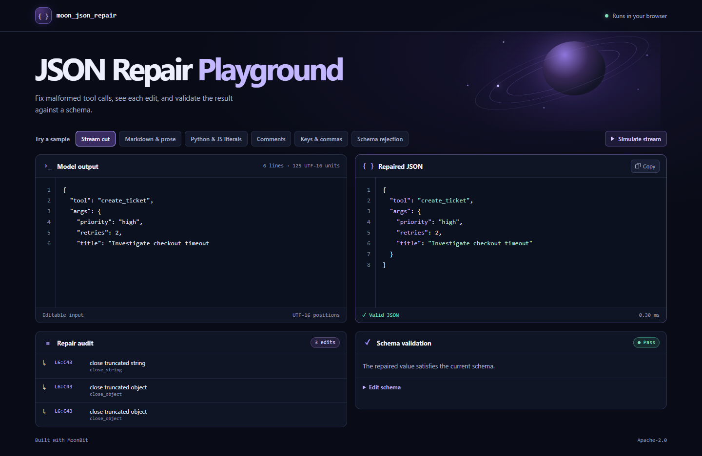

# moon_json_repair

[](https://github.com/ZSY2221/moon_json_repair/actions/workflows/ci.yml) [](LICENSE) 



按原始位置从混合回复提取独立工具调用。保留精确数字和可追踪修复日志。必要时按 Schema 自愈安全类型偏差，并为业务校验生成最短重试数据。

Extract independent tool calls from mixed replies, preserving exact number text and audit coordinates. Opt into safe schema-guided type fixes and generate bounded retry instructions for remaining errors.

[在线演练台 / Live demo](https://zsy2221.github.io/moon_json_repair/) · [快速开始 / Quick start](#快速开始--quick-start) · [CLI](#cli) · [基准 / Benchmarks](#基准--benchmarks) · [发布清单 / Release checklist](https://github.com/ZSY2221/moon_json_repair/blob/main/docs/PUBLISH_CHECKLIST.md)

## 能力 / Capability matrix

| 能力 / Capability | 默认行为与扩展 / Behavior and opt-in |
| --- | --- |
| 单块修复 / Single repair | Legacy default policy and API. Fences, comments, missing delimiters, exact decimal spelling and UTF-16 audit positions. |
| 多块提取 / Multi-call extraction | `extract_all` finds non-overlapping candidates in prose and fenced blocks, with absolute spans and a structural confidence score. |
| 流式检查点 / Stream checkpoint | Incremental lexical state from `push` and `status`. `finalize` seals the source and yields the authoritative repair report. |
| JSON5 数字 / JSON5 numbers | Opt-in hex integers, leading or trailing decimal dots and leading plus. Exact decimal audit, 1,024 hex digit budget. |
| Schema 与自愈 / Schema and coercion | Explicit `coerce_with_schema` converts supported exact string types and separately opted-in single-item arrays. `format_retry_prompt` reports remaining constraint errors. |
| 浏览器实验室 / Browser lab | Playback with checkpoints, paired audit highlights, raw report download, retry prompt copy, and live 10,000-iteration benchmarking. |
| 平台 / Targets | Wasm GC, JS and Native with zero external MoonBit modules and zero project FFI. |

## 快速开始 / Quick start

项目使用 MoonBit 0.1.20261119 验证。安装官方工具链后，可在仓库根目录先运行 `moon test`。模块发布后，在消费方模块中执行以下命令。

The project was verified with MoonBit 0.1.20261119. After installing the [official toolchain](https://www.moonbitlang.com/download/), run `moon test` from this checkout. Once the module is published, add it to a consuming module with the following command.

```sh
moon add ZSY2221/json_repair
```

在消费方的 `moon.pkg` 添加测试导入，再把下面两个示例粘贴到 `readme_test.mbt` 中，运行 `moon test --deny-warn`。在普通 `.mbt` 源文件中调用时，使用常规导入块。

Add the test import to the consumer's `moon.pkg`, paste both examples into `readme_test.mbt`, and run `moon test --deny-warn`. For production `.mbt` files, use a regular import block.

```moonbit
import {
  "ZSY2221/json_repair" @json_repair,
} for "test"
```

五行验证修复与 Schema 规则。 Five lines to check repair and schema validation.

```moonbit
test "five-line tool call repair" {
  let report = @json_repair.repair("{amount:42").unwrap()
  let schema : Json = { "required": ["amount"] }
  assert_true(@json_repair.validate(report.value, schema).is_empty())
}
```

以下示例修复截断的工具调用，再校验金额和货币。 This example repairs a truncated tool call and checks its amount and currency.

```moonbit
///|
test "repair and validate a tool call" {
  let input =
    #|{tool:'quote', args:{amount:125.50,currency:'SGD'
  guard @json_repair.repair(input) is Ok(report) else {
    fail("expected a repairable tool call")
  }
  let schema : Json = {
    "type": "object",
    "required": ["tool", "args"],
    "properties": {
      "tool": { "enum": ["quote"] },
      "args": {
        "type": "object",
        "required": ["amount", "currency"],
        "properties": {
          "amount": { "type": "number", "minimum": 0 },
          "currency": { "enum": ["SGD", "USD"] },
        },
      },
    },
  }
  assert_eq(
    report.json,
    (
      #|{"tool":"quote","args":{"amount":125.50,"currency":"SGD"}}
    ),
  )
  assert_true(!report.edits.is_empty())
  assert_true(@json_repair.validate(report.value, schema).is_empty())
}
```

把模型的每个 chunk 交给 `RepairStream::push`，用 `preview()` 读取当前前缀的临时结果，直到传输结束。预览会重新解析当前缓冲区，单次耗时随前缀长度变化。

Feed chunks to `RepairStream::push` and observe open delimiters and the last balanced position through `status()`. A preview reparses the accumulated prefix. Call `finalize()` on end of input, validate the final report, and reset the stream before reuse.

```moonbit
///|
test "preview while the model is streaming" {
  let stream = @json_repair.RepairStream::new()
  guard stream.push(
      (
        #|{"args":{"city":"Sing
      ),
    )
    is Ok(_) else {
    fail("chunk was rejected")
  }
  guard stream.preview() is Ok(preview) else { fail("preview was rejected") }
  assert_eq(
    preview.json,
    (
      #|{"args":{"city":"Sing"}}
    ),
  )
  guard stream.push(
      (
        #|apore"}}
      ),
    )
    is Ok(_) else {
    fail("chunk was rejected")
  }
  guard stream.preview() is Ok(completed) else { fail("result was rejected") }
  assert_eq(
    completed.json,
    (
      #|{"args":{"city":"Singapore"}}
    ),
  )
  assert_true(completed.edits.is_empty())
}
```

## 批量提取与纠错 / Extraction and retries

扩展能力在对应入口显式开启。低置信度表示结构或修复证据较弱。每个调用仍应独立完成 Schema 校验和执行授权。

Opt in through the dedicated APIs. Lower confidence marks weaker structural evidence. Validate and authorize each tool call independently.

```moonbit
///|
test "extract two payloads and preserve a JSON5 integer" {
  let options : @json_repair.RepairOptions = {
    ..@json_repair.RepairOptions::default(),
    json5: true,
  }
  let reply = "First {id:0x20000000000001}\nThen [.5]"
  let blocks = @json_repair.extract_all(reply, options).unwrap()
  assert_eq(blocks.length(), 2)
  assert_eq(blocks[0].report.json, "{\"id\":9007199254740993}")
  assert_eq(blocks[1].report.json, "[0.5]")
}

///|
test "coerce a numeric argument and request a precise retry" {
  let input : Json = { "amount": "42.5", "currency": "BTC" }
  let schema : Json = {
    "properties": {
      "amount": { "type": "number", "minimum": 0 },
      "currency": { "enum": ["USD", "SGD"] },
    },
  }
  let healed = @json_repair.coerce_with_schema(input, schema)
  assert_eq(healed.edits.length(), 1)
  assert_eq(healed.errors[0].path, "$.currency")
  let prompt = @json_repair.format_retry_prompt(healed.value, schema)
  assert_true(prompt.contains("$.currency"))
}
```

## 修复约定 / Repair contract

- `RepairReport.json` 是紧凑 JSON，保留合法字符串转义、对象字段顺序和数字原始拼写。`value` 是 MoonBit 标准库 `Json` AST 的公共别名。`edits` 按发现顺序记录，格式化空白没有审计条目。

  `RepairReport.json` is compact JSON and retains valid escape spellings, field order, and numeric text. `value` uses MoonBit's `Json` AST. Edits are reported in discovery order. Formatting whitespace does not produce an event.
- 审计 `position.offset` 从 0 开始，`line` 和 `column` 从 1 开始。偏移和列按 UTF-16 代码单元计数，`end_offset` 不包含端点，CRLF 算一个换行。

  The offset is zero-based. Line and column are one-based. Offsets and columns count UTF-16 code units. `end_offset` is exclusive, and CRLF counts as one newline.
- EOF 处没有值的末尾对象字段会被移除并记录。未知、截断和未配对的转义会保留为文本。重复键、第二个 JSON 根、不完整的数字词元和输入中的未配对 UTF-16 代码单元返回类型化错误。默认输入上限为 1,048,576 个 UTF-16 代码单元，嵌套深度 128，审计条目 16,384，可通过 `RepairLimits` 调整。

  A final member without a value is dropped and audited. Unknown, cut-off, and unpaired escapes are retained as text. Duplicate keys, competing JSON roots, incomplete number tokens, and raw lone UTF-16 surrogates return typed errors. Defaults are 1,048,576 UTF-16 input units, 128 levels, and 16,384 edits. Use `RepairLimits` to tune them.
- Schema 支持布尔规则和类型联合，字符串长度按 Unicode 码点计算。定义错误以 `$schema` 开头，实例错误以 `$` 开头，例如 `$.args.amount`。当前约束集以功能表为准，未知校验关键字会产生定义错误。

  Boolean schemas and type unions are supported. String lengths count Unicode code points. Definition paths start at `$schema` and instance paths at `$`. Unsupported validation keywords produce definition errors.

## CLI

原生 CLI 读取 UTF-8 文件或标准输入。Linux 需要可用的 C 编译器。Windows 可使用 WSL，在上面的三个库后端中，Native 通过 Ubuntu 22.04 验证。

The native CLI reads a UTF-8 file or stdin. Use an environment with a C compiler. Native verification was run on Ubuntu 22.04 under WSL.

```sh
moon run --target native cmd/main -- ./tool-output.txt
moon run --target native cmd/main -- --schema ./tool-schema.json ./tool-output.txt
printf '%s' "{tool:'quote',args:{amount:12.50" | moon run --target native cmd/main -- -
```

标准输出是一份 JSON 报告，包含 `json`、`value`、`edits`、`schema`。提供 Schema 时，`schema` 含 `valid` 和 `errors`。`0` 表示修复及可选校验成功，`3` 表示修复成功且 Schema 校验失败。I/O、修复和用法错误以 JSON 写到标准错误，分别使用 `1`（运行错误）和 `2`（用法错误）。构建后的 CLI 可直接运行，保留相同的参数与退出码。

Stdout is one JSON report with `json`, `value`, `edits`, and `schema`. With a schema, the last field contains `valid` and `errors`. Exit status `0` indicates success and `3` indicates a repaired document that failed schema validation. Runtime and usage errors are JSON on stderr with status `1` and `2` respectively. Run the built executable directly to retain those exact process exit codes.

## 演练台 / Playground

从源码仓库打开 `web/index.html` 即可离线使用。内置六个基础样本和扩展示例。流式播放支持 30 / 60 / 120 tok/s、暂停、单步和重放，速率指演练台模拟分片而非模型 tokenizer。审计支持双栏定位，下载保留 MoonBit 原始报告字节。[源码仓库](https://github.com/ZSY2221/moon_json_repair)

Open `web/index.html` directly from a repository checkout. The offline lab supports 30 / 60 / 120 simulated chunks per second, pause, single-step and replay. Audit records map to source and repaired output, and downloads keep the original MoonBit report text. Enable JSON5 numbers, schema coercion, or extraction explicitly.

`web/engine.js` 由 `cmd/playground` 通过 MoonBit JS 后端编译。以下脚本将编译产物复制到离线页面。[GitHub Pages 发布清单](https://github.com/ZSY2221/moon_json_repair/blob/main/docs/PUBLISH_CHECKLIST.md#2-推送-github-并部署-pages)

`web/engine.js` is generated from `cmd/playground` using the MoonBit JS backend. Rebuild it with the following command. [GitHub Pages deployment checklist](https://github.com/ZSY2221/moon_json_repair/blob/main/docs/PUBLISH_CHECKLIST.md#2-推送-github-并部署-pages)

```sh
node web/build.mjs
```

Pages 工作流会从选定提交重新构建引擎，再上传 `web/` 的静态文件。The Pages workflow rebuilds the engine from the selected commit before uploading the static files.

## 验证 / Verification

```sh
moon fmt --check
moon check --deny-warn
moon test
moon test --target js
moon test --target native
moon doc
node tools/verify-readme.mjs
```

Wasm GC、JS、Native 各通过 **349/349** 项测试。2,400 个固定种子样本分别跑默认修复、JSON5 修复和多块提取，成功输出均复核为严格 JSON 并保持幂等。Wasm GC 核心覆盖 **1,474/1,485（99.3%）**。

Each backend passed **349/349** tests. The same 2,400 seeded inputs exercise default repair, JSON5 repair and extraction. Every successful result is checked for strict JSON and idempotence. Wasm GC core coverage is **1,474/1,485 (99.3%)**.

## 基准 / Benchmarks

### JS 优化前后对照 / JS follow-up

Windows Ryzen 9 8945HX、Node v24.20.0、MoonBit 0.1.20261119。每项为十组 release 测量均值，基线 `8a3469b` 与优化版使用相同样本。流式分片这一行只计写入和读取一次检查点。

Each row compares ten release batches on the same input and toolchain against `8a3469b`. The stream row measures appending shards and reading one checkpoint.

| 场景 / Workload | 基线 / Baseline | 优化后 / Optimized |
| --- | ---: | ---: |
| 约 100 KB 截断 ASCII 字符串 / Truncated string | 977.24 µs | 612.20 µs |
| Emoji 和转义字符 / Emoji and escapes | 1.72 ms | 1.17 ms |
| 2,000 个流式分片 / Stream shards | 522.53 µs | 97.89 µs |
| 100 KB 畸形工具调用 / Malformed tool calls | 18.53 ms | 16.00 ms |

```sh
moon bench --target js --release --no-parallelize -p ZSY2221/json_repair -f repair_bench_test.mbt
moon bench --target js --release --no-parallelize -p ZSY2221/json_repair -f scaling_bench_test.mbt
```

### 四档输入 / Throughput

下方三后端与产物体积表记录 `8a3469b` 的基线。单元格为平均延迟（µs）与吞吐量（十进制 MB/s）。用重复工具调用和末尾截断构造等比例 ASCII 输入，MoonBit release，每项十组重复。Windows Ryzen 9 8945HX，JS 用 Node v24.20.0，Native 用 Ubuntu 22.04 WSL。

The cross-backend and size tables below record the `8a3469b` baseline. Each cell shows mean latency in microseconds and throughput in decimal MB/s. Fixtures contain repeated tool calls and a truncated tail. Ten release batches ran on a Ryzen 9 8945HX using Windows Wasm GC, Node v24.20.0 for JS, and Ubuntu 22.04 WSL for Native.

| 输入 / Input | Wasm GC | JS | Native (WSL) |
| --- | ---: | ---: | ---: |
| 200 B | 5.81 · 34.42 | 25.02 · 7.99 | 6.43 · 31.10 |
| 2,000 B | 61.61 · 32.46 | 310.43 · 6.44 | 67.59 · 29.59 |
| 20,000 B | 657.36 · 30.42 | 3,340.00 · 5.99 | 689.93 · 28.99 |
| 100,000 B | 3,510.00 · 28.49 | 18,160.00 · 5.51 | 3,500.00 · 28.57 |

固定深度和字面量预算下，扫描器按 UTF-16 单元向前推进。提取器修复的候选不重叠，其总长度至多为输入长度。流式 `push` 只看新分片，`status` 读取受限栈。以上复杂度按平均常数哈希操作计。十六进制转十进制使用独立的整数运算，位数上限为 1,024。Schema 比较和逐片重复预览不在四档测量范围内。

With bounded depth and literal limits, the lexer scans forward by UTF-16 code unit. Extracted repair slices are disjoint and total at most the input length. Stream `push` scans only the new shard, and `status` reads the bounded stack. The argument assumes average constant-time lookup. Hex conversion is bounded separately at 1,024 digits. Schema validation and repeated preview work are outside this throughput measurement.

### 分片预览 / Streaming

1,024 字节的同一截断样本。每格为逐片预览总耗时 → 只在结尾 `finalize()` 的总耗时（µs），再列出比值。计时前断言两条路径的 JSON 及审计日志相同。词法检查点是增量的，预览仍按当前完整前缀修复。

Same 1,024-byte fixture. Each cell shows eager per-chunk preview → final-only time in µs and the ratio. Both paths assert identical JSON and audit before timing. The lexical checkpoint is incremental, and an explicit preview reparses the current prefix.

| 分片 UTF-16 / Chunk | Wasm GC | JS | Native (WSL) |
| ---: | ---: | ---: | ---: |
| 16 | 1,140.00 → 39.32 · 28.99× | 5,370.00 → 170.94 · 31.41× | 1,220.00 → 40.38 · 30.21× |
| 64 | 339.09 → 36.87 · 9.20× | 1,480.00 → 156.75 · 9.44× | 350.26 → 38.16 · 9.18× |
| 256 | 119.12 → 37.33 · 3.19× | 536.55 → 157.33 · 3.41× | 127.47 → 38.55 · 3.31× |

### 六例与产物 / Six fixtures and probe sizes

六个已知畸形样本，严格解析接受 0/6，修复恢复 6/6。最终 Schema 失败例仍有业务字段错误。JS release 小样本中位单次修复 3.87–4.35 µs，取九批各 10,000 次。以下体积为同一有效输入的精简探针（字节，原始 / gzip -9），包含各后端运行时。

Strict parsing accepted 0/6 and repair recovered 6/6 on the malformed fixtures. The deliberate schema failure still reports its business errors. JS small-fixture medians were 3.87–4.35 µs over nine batches of 10,000. Probe sizes below include the runtime and use the same valid input. Values are raw / gzip -9 bytes.

| 后端 / Target | 严格探针 / Strict probe | 修复探针 / Repair probe |
| --- | ---: | ---: |
| Wasm GC | 73,052 / 38,325 | 83,832 / 40,413 |
| JS | 259,490 / 44,004 | 353,055 / 54,905 |
| Native (WSL) | 561,816 / 242,159 | 595,880 / 254,575 |

```sh
node tools/release-bench.mjs --native-wsl Ubuntu-22.04
```

[变更记录 / Changelog](https://github.com/ZSY2221/moon_json_repair/blob/main/docs/CHANGELOG.md) · [Apache-2.0](LICENSE)
